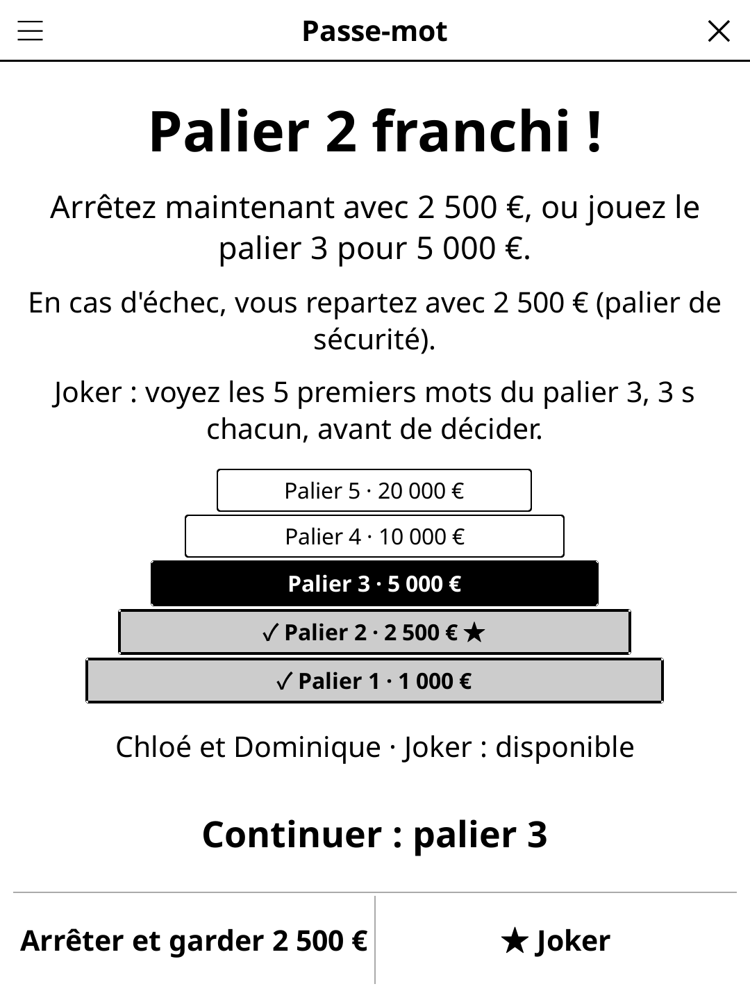

# passeword.koplugin

**Pass the Word** (FR *Passe-mot*) — a word-guessing party game for four
players around one [KOReader](https://github.com/koreader/koreader) device.
Two teams of two: one player gives one-word clues, the partner guesses.
Inspired by the classic TV word-guessing game format (qualification rounds,
then a final with a prize pyramid).

## Screenshot



## Rules

- **Teams A and B**, each a clue-giver and a guesser. The clue-giver holds the
  reader and sees the word; the guesser must not see the screen. Before every
  turn a neutral hand-over screen says who gives the clues and who looks away;
  the word only appears after **Ready**.
- **Qualification** — 4 rounds; in each, every team plays 30 s with 5 words.
  Round 1: player 1 gives clues to player 2; round 2: roles reversed; rounds
  3–4 like 1–2. Clues are one word at a time, as many as you like.
  - **Found**: +1.
  - **Pass**: the word goes to the end of the turn's list, it comes back if
    time remains.
  - **Forbidden!**: the clue wasn't allowed, the word is lost.
  - **Undo** takes back the last tap.
- The team with the most points plays the **final**. On a tie, the
  **tie-break**: one word for both teams, the two clue-givers take 10 s turns
  (a black banner shows whose turn it is); the first team to find it wins, a
  forbidden clue eliminates the team that gave it.
- **Final** — a ladder of 5 levels: 1 000 · 2 500 · 5 000 · 10 000 · 20 000
  (fake euros or points, setting). On each level find 5 words in 1:30 out of
  10, 9, 8, 7, then 6 words, harder each level. At most 3 clues per word (tap
  **Clue given** after each; after the 3rd the word is lost if not found);
  **Pass** or a forbidden clue loses the word for good. After a cleared level:
  **stop and keep** the prize, or **continue**. Level 2 is the **safety
  level** (2 500 guaranteed); a failed level ends the game with the safety
  amount, or nothing before it. The **joker**, unlocked at the safety level,
  can be used once: before a later level it shows that level's first 5 words,
  3 s each, then you decide. The roles can be swapped before each level.
- **Forbidden clues**: the word itself, invented words, compound/hyphenated
  words, translations, words of the same family or starting with the same
  syllable, miming or pointing, brand names and acronyms, spelling or
  splitting the word, two different clues in a row. **Allowed**: intonation,
  rhymes, repeating a clue, homophones. Plurals and feminine forms are
  accepted as answers.
- **Swap partners in rounds 3–4** (setting, off by default): rounds 3–4 pair
  player 1 with player 4 and player 3 with player 2, the ranking becomes
  individual and the two best players play the final (two players tied for
  second behind a leader play a tie-break in which they both give clues to
  the leader; any other tie is drawn by lot).

## Features

- Big word, as large as the screen allows; only the timer refreshes each
  second (e-ink friendly).
- Player names typed once (one per line) and remembered.
- Word banks written natively in French and English, tagged by difficulty;
  the qualification draws difficulties 1–2 (rounds 1–2) and 2–3 (rounds 3–4),
  the tie-break 2–3, final level *n* difficulty *n*. No word comes back twice
  in a game, and a word dealt in an earlier game only comes back once its
  whole difficulty level has been played:

  | Difficulty | EN | FR |
  |------------|----|----|
  | 1 — everyday nouns | 458 | 455 |
  | 2 | 396 | 375 |
  | 3 | 339 | 349 |
  | 4 | 280 | 279 |
  | 5 — hard / abstract | 214 | 229 |
  | **Total** | **1687** | **1687** |

  Levels 2–5 include famous people, monuments, cities, countries and fictional
  characters (Napoléon, Molière, Cléopâtre, tour Eiffel, Sherlock Holmes…).
  The word language is its own setting (**Language: FR/EN**), defaulting to
  KOReader's language; the interface follows KOReader.
- Saved when the screen closes; a turn interrupted by closing the game resumes
  on its hand-over screen and is replayed with new words (never on a visible
  word).

## Installation

Copy `passeword.koplugin/` into KOReader's `plugins/` folder, with the shared
`game-common/` library as its `common/` folder (the release zip includes it).
**Pass the Word** then appears in the Tools menu.

## Development

`game.lua` is the game logic (no UI). `test_game_spec.lua` covers it and checks
the word banks (counts per level, duplicates, proper nouns, excluded names and
brands):

```
busted test_game_spec.lua
```

## License

GPL-3.0
